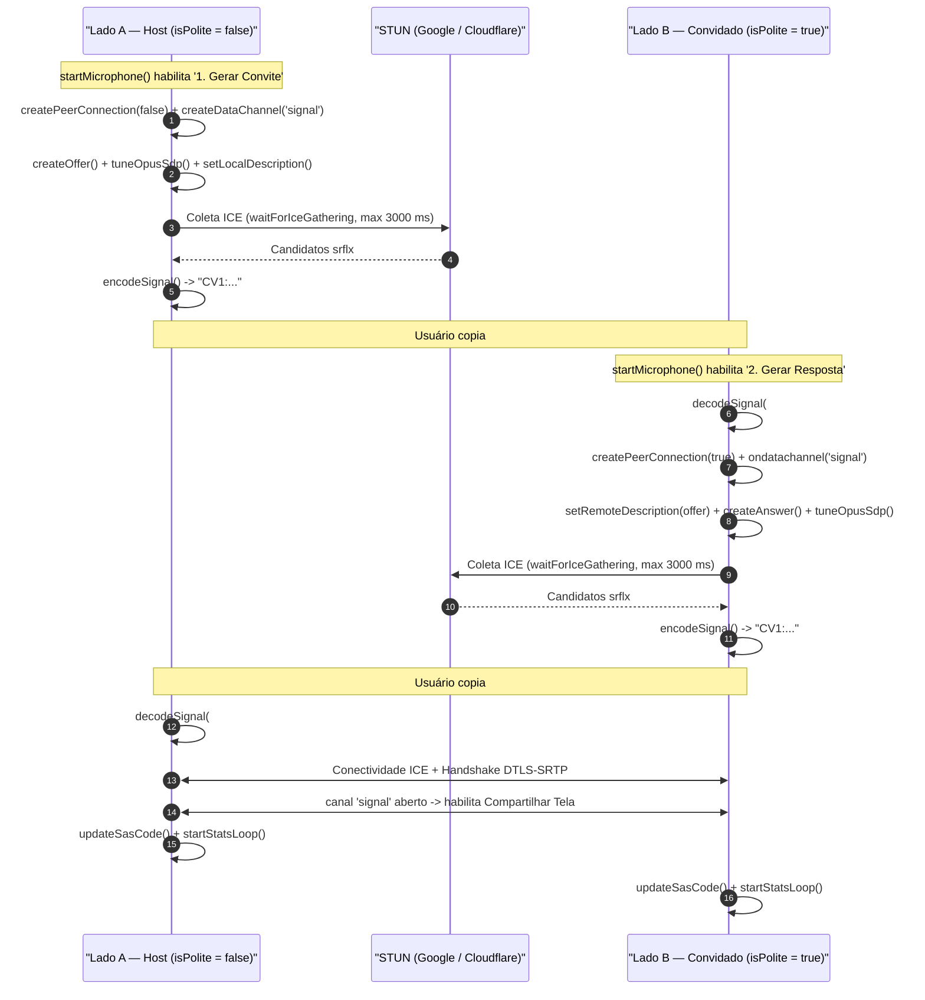

# 02 — Sinalização e WebRTC

Este documento detalha como o PeerBuddy estabelece, renegocia e encerra conexões WebRTC sem servidor central.

---

## 1. Fluxo Completo de Conexão (Lado A e Lado B)



---

## 2. Codificação Compacta (`CV1:` e `CV0:`)

As funções `encodeSignal(desc)` e `decodeSignal(input)` convertem o `RTCSessionDescription` em uma string copiável:

1. **Compactação de chaves:** cria um JSON mínimo com `{ t: 'o' | 'a', s: desc.sdp }`, onde `'o'` representa `offer` e `'a'` representa `answer`.
2. **Compressão (`CV1:`):** se `CompressionStream` estiver disponível no WebView, comprime os bytes UTF-8 usando o algoritmo `'deflate-raw'` e converte para Base64url (`toBase64Url`, substituindo `+` por `-`, `/` por `_` e removendo `=`). Segundo comentário no código, reduz o tamanho do convite em ~75%.
3. **Fallback (`CV0:`):** se `CompressionStream` não existir, codifica o JSON UTF-8 diretamente em Base64url com prefixo `CV0:`.
4. **Validação na decodificação:** `decodeSignal` remove espaços nas extremidades (`trim()`) e exige prefixo `CV1:` ou `CV0:`; caso contrário, lança `Error('Formato inválido. O código deve começar com CV1:')`.

---

## 3. Configuração ICE (STUN e TURN)

Em `createPeerConnection(polite)`:

```js
const iceServers = [
  { urls: 'stun:stun.l.google.com:19302' },
  { urls: 'stun:stun.cloudflare.com:3478' },
];
```

- Se o campo `#turnUrl` estiver preenchido (opção avançada), um objeto adicional é incluído em `iceServers` com `urls`, `username` (`#turnUser`) e `credential` (`#turnPass`).
- **Coleta inicial (`waitForIceGathering`):** aguarda `peer.iceGatheringState === 'complete'` ou estoura um timeout de **`3000 ms`**, garantindo que o código `CV1:` já contenha os candidatos ICE descobertos sem travar indefinidamente caso algum servidor STUN não responda.

---

## 4. Estados da Conexão ICE

O listener `pc.oniceconnectionstatechange` atualiza o badge principal (`#connBadge`):

| `pc.iceConnectionState` | Texto do Badge | Classe CSS | Ações disparadas |
| :--- | :--- | :--- | :--- |
| `'checking'` | `Conectando P2P...` | `warn` | — |
| `'connected'` / `'completed'` | `Conectado P2P` | `ok` | Habilita `#btnHangup`, chama `updateSasCode()` e `startStatsLoop()`. |
| `'disconnected'` / `'failed'` | `Conexão perdida / Falhou` | `err` | — |
| `'closed'` | `Desconectado` | padrão | — |

---

## 5. Renegociação via `RTCDataChannel` (`signal`)

Uma vez conectados, os dois peers não precisam mais gerar códigos `CV1:`:

- O Lado A (`polite = false`) cria o DataChannel `'signal'` antes da oferta inicial.
- O Lado B (`polite = true`) recebe o canal via `pc.ondatachannel`.
- Quando o canal abre (`ch.onopen`), o botão `#btnShareScreen` é habilitado e `#screenStatus` informa que a tela pode ser compartilhada.

### 5.1 Padrão *Perfect Negotiation*

- **`pc.onnegotiationneeded`:** se `signalChannel?.readyState === 'open'`, define `makingOffer = true`, cria oferta, aplica `tuneOpusSdp`, define `localDescription` e envia `{ description: pc.localDescription }` pelo DataChannel. Reseta `makingOffer = false` no `finally`.
- **`pc.onicecandidate`:** envia candidatos incrementais `{ candidate: ev.candidate }` pelo DataChannel quando aberto.
- **`ch.onmessage`:**
  - `{ type: 'screen-stopped' }`: limpa `els.remoteVideo.srcObject` e remove a classe `.active` de `#remoteScreenBox`.
  - `{ description }`: detecta colisão de ofertas (`msg.description.type === 'offer' && (makingOffer || pc.signalingState !== 'stable')`). Se houver colisão e `!isPolite`, ignora a oferta recebida; caso contrário aplica `setRemoteDescription`, e se for `'offer'`, gera e envia a `answer` (também passando por `tuneOpusSdp`).
  - `{ candidate }`: chama `pc.addIceCandidate(msg.candidate)` (silenciando eventuais erros de candidato tardio).

---

## 6. Encerramento da Chamada (`hangup`)

Ao clicar em **Desconectar** (`#btnHangup`):

1. Chama `stopScreenShare()` (para faixas da tela, remove senders e envia `{ type: 'screen-stopped' }` se possível).
2. Para o timer de estatísticas (`clearInterval(statsTimer)`).
3. Fecha e descarta `pc` (`pc.close(); pc = null`), além de zerar `signalChannel` e `voiceSender`.
4. Limpa `srcObject` de `#remoteAudio` e `#remoteVideo` e oculta `#remoteScreenBox` e `#sasBadge`.
5. Desabilita botões de chamada/compartilhamento/cópia, limpa os 4 textareas de sinalização (`offerOut`, `answerIn`, `offerIn`, `answerOut`) e reseta todos os campos de telemetria para `--`.
