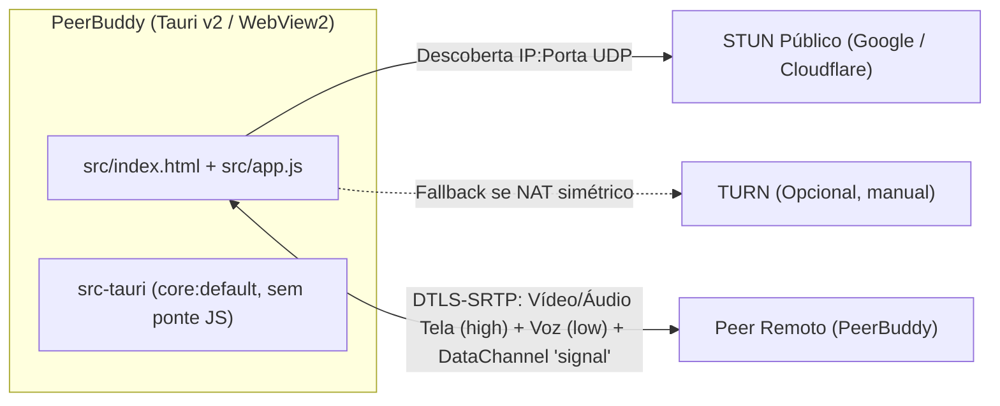

# Documentação Técnica — PeerBuddy (v0.1.0)

Bem-vindo à documentação técnica completa do **PeerBuddy**, um aplicativo desktop P2P leve desenvolvido com **Tauri v2** e **WebRTC nativo** para transmissão de tela e voz ponto a ponto, sem servidores centrais, sem contas e com isolamento estrito.

---

## Índice da Documentação

| Documento | Conteúdo |
| :--- | :--- |
| [01 — Arquitetura e Tauri](01-arquitetura-e-tauri.md) | Stack tecnológica, estrutura de pastas, backend Rust mínimo, `tauri.conf.json`, perfil de compilação e modelo sem bundler. |
| [02 — Sinalização e WebRTC](02-sinalizacao-e-webrtc.md) | Handshake manual (`CV1:` / `CV0:`), compressão `deflate-raw`, coleta ICE, STUN/TURN, `RTCDataChannel` (`signal`), *Perfect Negotiation* e `hangup()`. |
| [03 — Mídia, Codecs e Prioridade](03-midia-codecs-e-prioridade.md) | Microfone, medidor Web Audio, ajuste Opus no SDP, captura de tela (`getDisplayMedia`), presets, modos `motion`/`detail`, codecs (H.264/VP9/AV1) e `jitterBufferTarget`. |
| [04 — Telemetria e Interface (UI)](04-telemetria-e-ui.md) | Design system Windows XP/2000, mapa de elementos DOM (`els`), atalhos, fluxos de estado da UI e métricas de `pc.getStats()`. |
| [05 — Segurança e Isolamento](05-seguranca-e-isolamento.md) | Criptografia DTLS-SRTP, cálculo do código SAS (`Segurança: XXX-XXX`), `withGlobalTauri: false`, CSP estrita, capabilities `core:default` e zero persistência. |
| [06 — Referência de Código (`app.js`)](06-referencia-codigo.md) | Catálogo completo de variáveis de estado, funções, parâmetros e *event listeners* do frontend. |
| [07 — Build, CI/CD e Contribuição](07-build-ci-e-contribuicao.md) | Compilação local, workflows do GitHub Actions (`ci.yml` e `release.yml`), hooks `pre-commit` e regras de auditoria. |

---

## Arquitetura de Alto Nível

---

## Princípios de Design do Projeto

1. **Zero servidor próprio:** toda a sinalização inicial é feita por troca manual de strings compactas (`CV1:...`) entre os dois usuários.
2. **Prioridade absoluta para a tela:** vídeo da tela (`high`, até 25 Mbps) e áudio da tela (`high`, até 192 kbps estéreo) têm prioridade de rede superior à voz do microfone (`low`, limitado a 32 kbps).
3. **Isolamento defensivo:** o frontend roda sob CSP estrita, com `withGlobalTauri: false` e apenas a capability `core:default` no Tauri v2, impedindo acesso a sistema de arquivos, shell ou rede HTTP arbitrária.
4. **Zero persistência:** nenhuma configuração, código `CV1:`, chave DTLS ou histórico é gravado em disco.
